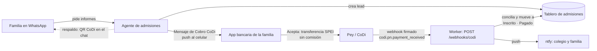

# Inscripción con CoDi

**La familia paga la inscripción del colegio con CoDi®, sin comisión, desde la misma conversación de WhatsApp en la que pidió informes. El colegio la ve conciliada al instante en su tablero de admisiones y recibe un aviso push.**

Proyecto para el **Hackatón México 2026** (kickoff León), organizado por SpaceXAI, Pey y AI Builders México · equipo **SuperLeads**.

▶ **Demo en vivo:** https://inscripcion-codi.noisy-shape-4fc9.workers.dev
(datos ficticios · CoDi simulado · no se mueve dinero)

**El dinero va directo a la CLABE del colegio.** SuperLeads orquesta la conversación y el CRM, pero nunca recibe ni concentra fondos (Reglas del SPEI de Banxico, regla 9a. Bis 1). SuperLeads no es participante del SPEI: los participantes son los bancos. Qué dice la regulación de CoDi y cómo la aplica la demo: [docs/regulacion.md](docs/regulacion.md).

> **Aviso de privacidad (demo):** el celular de la familia, el mismo del chat, se comparte con el proveedor de pagos (Pey) solo para enviarle el cobro CoDi. En producción, el aviso de privacidad del colegio y el de SuperLeads lo cubren (LFPDPPP).

---

## El problema

En un colegio privado, el momento más frágil de la admisión es el paso de *«me interesa»* a *«ya pagué la inscripción»*:

- La familia pide informes por WhatsApp, pero para pagar la mandan a otro lado: depósito, transferencia con una CLABE copiada a mano o terminal con comisión.
- Después manda la foto del comprobante por WhatsApp, y alguien de admisiones la cuadra a mano contra el estado de cuenta.
- Mientras tanto el lead se enfría, el lugar no queda apartado y el CRM no sabe quién ya pagó.

**CoDi** (Cobro Digital de Banxico) resuelve el pago: SPEI 24x7, inmediato y **sin comisión**, con el cobro llegando directo a la app bancaria del pagador. Lo que falta es conectarlo con la conversación y con el CRM. Eso hace este proyecto.

## Cómo funciona

1. La familia escribe por WhatsApp. El agente le da informes y crea el lead en el CRM.
2. La familia confirma el monto (*«sí, aparta el lugar»*). Antes del push, el agente le escribe los datos exactos que verá en su banco: razón social del beneficiario («Colegio Aurora, S.C. (demo)»), monto, concepto, referencia, hasta qué hora vale y «sin comisión».
3. El agente manda un **Mensaje de Cobro CoDi por notificación push** a la app bancaria ligada al celular del chat. El monto es exactamente el confirmado, sin recargo. El concepto tiene 40 caracteres o menos, sin datos del menor, la referencia hasta 7 dígitos y la vigencia es de 30 min.
4. En su banco, la familia puede **Aceptar, Rechazar o Posponer**. Si acepta, se ejecuta la transferencia CoDi.
5. El proveedor (Pey) avisa por **webhook firmado** a `POST /webhooks/codi`.
6. El Worker verifica la firma, descarta `webhook-id` repetidos y **compara monto y referencia con el cobro original**. Si coinciden, mueve el lead a **«Inscrito · Pagado»**. Si no, rechaza el pago, lo deja en revisión y lo registra en la bitácora y el log.
7. Sale un **push con ntfy** al colegio («Familia X inscrita y pagada») y otro a la familia con el Folio CoDi, la clave de rastreo y la CLABE enmascarada. En la demo, el de la familia es simulado.

**Respaldo:** si la familia rechaza el push o no le llega, el agente manda un **QR CoDi** en el chat (o una liga de pago). Es un cobro nuevo, con referencia nueva y el mismo monto.

**Vencimiento:** Pey solo manda webhook cuando se paga, no cuando se rechaza o vence. Al llegar la vigencia, la alarma del Durable Object consulta `GET /transaction/{id}` (o `GET /transaction/codi/qr/{id}` para el QR). Si sigue en `PENDING`, el cobro queda **«vencido o rechazado»** y el agente ofrece uno **nuevo**, con folio y referencia nuevos. Un cobro vencido nunca se reutiliza.



### Secuencia: webhook → tablero → ntfy

```mermaid
sequenceDiagram
  autonumber
  participant Fam as Familia (app bancaria)
  participant Pey as Pey / Banxico CoDi
  participant W as Worker /webhooks/codi
  participant T as Tablero (Durable Object)
  participant N as ntfy
  participant Col as Colegio (celular)

  Fam->>Pey: Acepta el Mensaje de Cobro
  Pey->>W: POST /webhooks/codi<br/>webhook-id · webhook-timestamp · webhook-signature
  W->>W: Verifica HMAC-SHA256 con CODI_WEBHOOK_SECRET<br/>y que el timestamp tenga menos de 5 min
  alt firma inválida
    W-->>Pey: 401
  else firma válida
    W->>T: aplicarPago(webhook-id, pago)
    T->>T: Idempotencia por webhook-id<br/>Busca el lead: leadId → id de transacción → referencia + monto<br/>Compara monto y referencia con el cobro original
    alt no coincide
      T-->>W: no_coincide · lead en revisión · sin ntfy
    end
    T-->>W: conciliado · lead en «Inscrito · Pagado»
    W->>N: POST /tema «Colegio · Familia inscrita y pagada»
    N-->>Col: push
    W->>N: POST /tema «Familia · recibimos tu pago» (simulado)
    W-->>Pey: 200 { resultado, ntfy: [200, 200] }
  end
  Note over T: El navegador consulta el tablero cada 1.5 s.<br/>La tarjeta se mueve sola; el navegador nunca marca el pago.
```

## Prueba la demo en 30 segundos

1. Abre https://inscripcion-codi.noisy-shape-4fc9.workers.dev
2. *(Opcional)* Recibe el push en tu celular. Toca **📲 Recibe el aviso en tu celular** y escanea el QR, o suscríbete a mano en la app **ntfy** (iOS / Android): **+** → activa *Use another server* → servidor `https://ntfy.envs.net` → tema `inscripcion-codi-vmjgfbix3cnxl74b`.

   

3. En el chat, toca las respuestas de la familia. Cuando aparezca la notificación del banco, ábrela y toca **Aceptar**. Con **Rechazar** verás el respaldo por QR. Con **(Demo) No contesto y pasan los 30 min** verás el vencimiento y un cobro nuevo.
4. La tarjeta pasa a **Inscrito · Pagado**, la bitácora muestra `webhook … firma ✓` y `ntfy … HTTP 200`, y el push llega a tu celular.

> El tema de ntfy de la demo es **público**: cualquiera que lo conozca recibe los avisos, que solo traen datos ficticios. En producción se usaría un tema privado por colegio con token de acceso (`NTFY_TOKEN`).

## Qué es real y qué es simulado

| Pieza | Estado |
|---|---|
| Worker en Cloudflare, API y tablero por escuela (Durable Object con SQLite) | **Real** |
| `POST /webhooks/codi`: verificación Standard Webhooks (HMAC-SHA256), anti-replay e idempotencia | **Real**, probado con el vector oficial de la especificación |
| Entrega del webhook en la demo | **Real por HTTP** (el Worker se llama a sí mismo por *service binding*); el evento lo **genera** el mock |
| Conciliación (lead, transacción, referencia + monto); si el monto o la referencia no coinciden con el cobro original → rechazo y revisión | **Real** |
| Vencimiento: alarma del Durable Object que consulta el estado del cobro al llegar la vigencia | **Real**. En la demo, el botón «pasan los 30 min» adelanta el reloj del cobro y corre la misma revisión; el mock responde `PENDING` como Pey |
| Validaciones del cobro (concepto ≤ 40, referencia ≤ 7 dígitos, vigencia de 30–60 min, monto = confirmado) | **Real** |
| Push con ntfy al colegio | **Real** (HTTP 200 en la bitácora) |
| Push a la familia | **Simulado**: va al mismo tema de ntfy. En producción iría por WhatsApp |
| Conversación de WhatsApp | **Simulada**: guion fijo en el navegador |
| App bancaria (logo CoDi como marcador, Folio CoDi, beneficiario, monto, concepto, referencia, vigencia; Aceptar / Rechazar / Posponer) | **Simulada** |
| Cobro CoDi (push y QR) | **Simulado** (`PagosCoDiMock`). El QR dice `DEMO`: no lo pagues con un banco real |
| Adaptador Pey (`PagosCoDiPey`) | **Escrito contra la OpenAPI pública de Pey** y probado con un `fetch` falso. **Aún no se prueba con una API key real** |
| Escuela, familias, montos y celular (`0000000042`) | **Ficticios** |

## Arquitectura

```
public/                     Una sola pantalla: WhatsApp + app bancaria + tablero (HTML/CSS/JS sin framework)
src/worker.ts               Rutas /api/* y /webhooks/codi
src/pagos/tipos.ts          Interfaz PagosCoDi + validaciones CoDi y política del cobro
src/pagos/mock.ts           CoDi simulado (emite webhooks con la misma forma que Pey)
src/pagos/pey.ts            Cliente de la API de Pey (api.pey.mx)
src/pagos/fabrica.ts        Elige mock o Pey según la configuración
src/vencimiento.ts          Revisión al vencer: consulta el estado y marca «vencido o rechazado»
src/mensajes.ts             Lo que el agente le dice a la familia antes del cobro + aviso de privacidad
src/webhooks.ts             Firma y verificación Standard Webhooks (WebCrypto)
src/conciliacion.ts         Lógica pura de conciliación
src/tablero.ts              Durable Object: CRM de admisiones por escuela
src/ntfy.ts                 Publicación de avisos push
scripts/enviar-webhook.mjs  Manda un webhook firmado para probar
test/                       44 pruebas (node --test)
docs/regulacion.md          Regulación CoDi (Banxico, CNBV, LFPDPPP) y cómo la aplica la demo
```

### La interfaz `PagosCoDi`

Es la única puerta entre el CRM y CoDi. Para pasar de simulado a Pey real basta con cambiar la clase que se instancia.

```ts
interface PagosCoDi {
  // PRINCIPAL: Mensaje de Cobro por notificación push a la app bancaria ligada al celular
  crearCobroPush(celular: string, solicitud: SolicitudCobro): Promise<CobroPush>;
  // RESPALDO: el mismo Mensaje de Cobro como QR
  crearCobroQR(solicitud: SolicitudCobro): Promise<CobroQR>;
  consultarTransaccion(id: string): Promise<EstadoTransaccion>;   // por si no llega el webhook
  estadoCobro(cobro: { medio; id }): Promise<EstadoCobro>;         // al vencer: ¿se pagó o sigue PENDING?
  interpretarWebhook(payload: unknown): PagoRecibido;             // evento → pago normalizado
}

interface SolicitudCobro {
  montoMXN: number;          // Monto
  concepto: string;          // Concepto de pago (≤ 40 caracteres, sin datos del menor)
  referencia: string;        // Referencia Numérica (1–7 dígitos): llave de conciliación, nueva en cada cobro
  vigenciaSegundos: number;  // Tiempo de vigencia (Pey ≥ 360; aquí de 30 a 60 min)
  metadatos: Record<string, string>;  // escuelaId, leadId (Pey los regresa en el webhook)
}
```

Los nombres siguen el vocabulario de Banxico (Reglas del SPEI, [Circular 8/2019](https://dof.gob.mx/nota_detalle_popup.php?codigo=5560699), Apéndice AD):

- *Mensaje de Cobro*: lo que genera el *Cliente Beneficiario* (el colegio) para el *Cliente Emisor* (la familia).
- Campos: **Monto**, **Concepto de pago**, **Referencia Numérica** y **Tiempo de vigencia**.
- El emisor puede **Aceptar, Rechazar o Posponer**. Si se cumple la vigencia sin respuesta, el mensaje pasa a *vencido*.

Detalle, artículos y fuentes oficiales en [docs/regulacion.md](docs/regulacion.md).

### El webhook `POST /webhooks/codi`

Usa el mismo esquema que Pey ([Standard Webhooks](https://www.standardwebhooks.com/)):

| Encabezado | Contenido |
|---|---|
| `webhook-id` | id único del mensaje (llave de idempotencia) |
| `webhook-timestamp` | unix en segundos; se rechaza si difiere más de 5 min |
| `webhook-signature` | `v1,` + base64(HMAC-SHA256(secreto, `${id}.${timestamp}.${cuerpo}`)) |

El secreto (`whsec_…`) es un **secreto del Worker** y **nunca va en el repo**:

```bash
npx wrangler secret put CODI_WEBHOOK_SECRET   # pega un whsec_<base64>; con Pey, el que da su portal
```

Respuestas: `200` con `resultado` (`conciliado`, `duplicado`, `no_coincide` o `sin_cobro`) · `401` firma inválida · `400` evento no soportado · `422` sin `escuelaId`. Solo `conciliado` dispara ntfy al colegio. `no_coincide` responde 200 para que el proveedor no reintente: el pago es real, pero no se marca como inscrito y queda en revisión (la devolución la hace el colegio desde su banco).

Para probarlo con un webhook firmado (el secreto se lee solo del entorno):

```bash
CODI_WEBHOOK_SECRET=whsec_… node scripts/enviar-webhook.mjs \
  --url http://localhost:8787 --escuela demo-xxxxxxxx --ref 1234567 --monto 4850
```

### ntfy

El Worker publica con `POST {NTFY_BASE}/{NTFY_TEMA}`, con título, etiquetas, prioridad y liga (`click`) al tablero. `NTFY_BASE` y `NTFY_TEMA` son variables en `wrangler.jsonc`; `NTFY_TOKEN` es un secreto opcional para temas privados.

**Nota:** `ntfy.sh` no responde a las peticiones que salen de Cloudflare Workers. Desde Workers da *timeout*; desde otras redes, el mismo POST responde 200. Por eso la demo publica en **`ntfy.envs.net`**, un servidor ntfy público. Si despliegas fuera de Cloudflare o con tu propio ntfy, cambia `NTFY_BASE` a `https://ntfy.sh` o a tu dominio.

## Cómo correrlo

Requiere Node 22.18+ (las pruebas usan `node --test` con TypeScript nativo).

```bash
npm ci
# secreto local (el archivo está en .gitignore)
node -e "console.log('CODI_WEBHOOK_SECRET=whsec_'+require('crypto').randomBytes(32).toString('base64'))" > .dev.vars
npm run dev          # http://localhost:8787
npm test             # 44 pruebas: firmas, conciliación, vencimiento, política del cobro, contrato de Pey, mock, ntfy
npm run typecheck
npx wrangler deploy  # y luego: npx wrangler secret put CODI_WEBHOOK_SECRET
```

## Ruta a la API real de Pey

Pey ya publica su API de CoDi en [docs.pey.mx](https://docs.pey.mx) (OpenAPI 2026-10-20). Incluye `POST /codi/pn` (push), `POST /codi/qr`, `GET /transaction/{id}` y los webhooks `codi.pn.payment_received` y `codi.qr.payment_received`, firmados con Standard Webhooks. `PagosCoDiPey` ya implementa ese contrato. Para encenderlo:

1. Crear la API key y ligar la cuenta CLABE del colegio en [portal.mipey.mx](https://portal.mipey.mx).
2. En el portal, apuntar el webhook a `https://<worker>/webhooks/codi` y guardar su secreto con `npx wrangler secret put CODI_WEBHOOK_SECRET`.
3. Correr `npx wrangler secret put PEY_API_KEY`, poner `"PAGOS_PROVEEDOR": "pey"` en `wrangler.jsonc` y `PEY_BANK_ACCOUNT_ID` con el `bankAccountId` de la CLABE del colegio (en estado ACTIVE), para que el dinero caiga directo ahí.
4. Probar con **$0.01 MXN** y bancos reales, como recomienda Pey mientras sale su ambiente de pruebas.
5. Cambiar el guion del navegador por el agente de WhatsApp real (WhatsApp Business API) con el celular verdadero de la familia.

Qué cubre Pey como procesador, qué le falta (reembolsos, recurrentes, tarjeta multi-colegio) y los límites de CoDi están en [docs/procesador-pagos.md](docs/procesador-pagos.md).

**Lo que necesitamos de Pey:**

- **Ambiente de pruebas** (anunciado como *coming soon*) para correr la demo de punta a punta sin dinero real.
- **Webhooks de rechazo y vencimiento** del Mensaje de Cobro push. Hoy solo existe `payment_received`; con ellos, el agente ofrecería el QR al instante en vez de esperar.
- Un **código de error claro cuando el celular no tiene CoDi** registrado, para caer al QR automáticamente.
- Confirmar que el `transactionId` del webhook push es el mismo que regresa `POST /codi/pn`. Mientras tanto, la conciliación también funciona por referencia + monto.
- Confirmar los caracteres admitidos en `concept`. Lo limitamos a 40, como pide la Circular 3/2012 (art. 17 Ter, fracc. IX), y lo mandamos sin acentos.

## Siguientes pasos

- Agente de WhatsApp real (SuperLeads ya opera agentes de admisiones por WhatsApp para colegios) y CRM real en lugar del tablero de demo.
- Colegiaturas mensuales: el mismo flujo, programado cada mes, con recordatorio antes de que venza.
- Payment Links de Pey como respaldo para pago con tarjeta.
- Tema privado de ntfy por colegio, o push dentro del propio CRM.

---

## English summary

**Inscripción con CoDi** lets a family pay a private school's enrollment fee with **CoDi** (Banxico's zero-fee instant payments) from the same WhatsApp chat where they asked for information. The school sees the payment reconciled instantly on its admissions board.

- **Primary flow:** the agent sends a CoDi **push payment request** to the family's phone (it already has the number from the chat). The family taps *Accept* in their banking app. A **signed webhook** then hits `POST /webhooks/codi` (Standard Webhooks, HMAC-SHA256, the same scheme Pey uses). The Worker reconciles the payment, the lead moves to *Enrolled · Paid*, and **ntfy** pushes a notification to the school; the family's notification is simulated.
- **Fallback:** the same charge as a CoDi QR code.
- **Compliance by design:** money goes straight to the school's CLABE and SuperLeads never holds funds. Each charge is validated before it is sent: concept of 40 characters or fewer, reference of up to 7 digits, 30–60 min expiry, and an amount equal to the one the family confirmed. An expired charge is never reused. At expiry, the Worker polls Pey's transaction endpoint. A webhook only triggers the school's notification after its signature is verified, its id is deduplicated, and its amount and reference match the original charge. See [docs/regulacion.md](docs/regulacion.md) (Spanish).
- **Stack:** Cloudflare Workers + Durable Objects + static assets, TypeScript, no frontend framework, 44 tests.
- **Mocked:** the CoDi charge, the bank app and the WhatsApp conversation. **Real:** webhook verification, reconciliation, state and the ntfy push. A `PagosCoDiPey` adapter is written against Pey's public OpenAPI but has not yet been run with a live API key.
- **Live demo:** https://inscripcion-codi.noisy-shape-4fc9.workers.dev. To get the push live, subscribe in the ntfy app to topic `inscripcion-codi-vmjgfbix3cnxl74b` on server `https://ntfy.envs.net`. ntfy.sh does not answer requests from Cloudflare Workers, so the demo uses that server instead.

All data is fictional. No real payments are made.

## Licencia

[MIT](LICENSE) · Victor Gallo · SuperLeads
