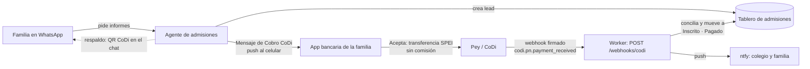
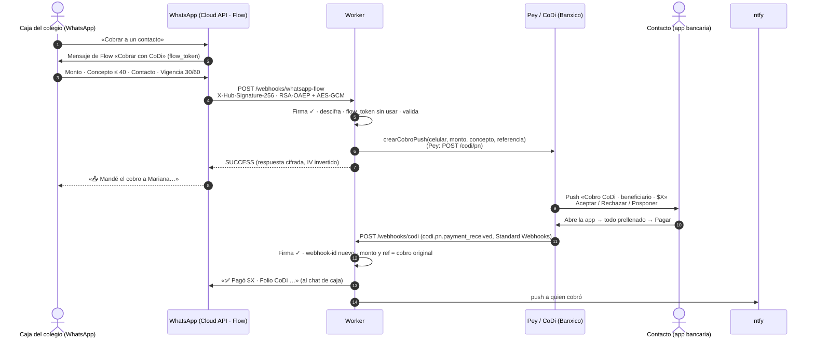

# Inscripción con CoDi

**La familia paga la inscripción del colegio con CoDi®, sin comisión, desde la misma conversación de WhatsApp en la que pidió informes. El colegio la ve conciliada al instante en su tablero de admisiones y recibe un aviso push.**

Proyecto para el **Hackatón México 2026** (kickoff León), organizado por SpaceXAI, Pey y AI Builders México · equipo **SuperLeads**.

▶ **Demo en vivo:** https://inscripcion-codi.noisy-shape-4fc9.workers.dev
(datos ficticios · CoDi simulado · no se mueve dinero)

La demo tiene dos modos, en una sola pantalla:

- **Inscripción**: la familia pide informes por WhatsApp y paga la inscripción con un push CoDi.
- **Cobrar a un contacto** ([ir directo](https://inscripcion-codi.noisy-shape-4fc9.workers.dev/?modo=contacto)): el colegio o negocio llena un formulario **dentro de WhatsApp** (WhatsApp Flow): monto, concepto, contacto y vigencia. Al contacto le llega el cobro CoDi a la app de su banco, con todo prellenado, y paga con un solo botón. Ver [Cobrar a un contacto desde WhatsApp](#cobrar-a-un-contacto-desde-whatsapp).

**El dinero va directo a la CLABE del colegio.** SuperLeads orquesta la conversación y el CRM, pero nunca recibe ni concentra fondos (Reglas del SPEI de Banxico, regla 9a. Bis 1). SuperLeads no es participante del SPEI: los participantes son los bancos. Qué dice la regulación de CoDi y cómo la aplica la demo: [docs/regulacion.md](docs/regulacion.md).

> **Aviso de privacidad (demo):** el celular de la familia, el mismo del chat, se comparte con el proveedor de pagos (Pey) solo para enviarle el cobro CoDi. En producción, el aviso de privacidad del colegio y el de SuperLeads lo cubren (LFPDPPP).

---

## El problema

En un colegio privado, el momento más frágil de la admisión es el paso de *«me interesa»* a *«ya pagué la inscripción»*:

- La familia pide informes por WhatsApp, pero para pagar la mandan a otro lado: depósito, transferencia con una CLABE copiada a mano o terminal con comisión.
- Después manda la foto del comprobante por WhatsApp, y alguien de admisiones la cuadra a mano contra el estado de cuenta.
- Mientras tanto el lead se enfría, el lugar no queda apartado y el CRM no sabe quién ya pagó.

**CoDi** (Cobro Digital de Banxico) resuelve el pago: SPEI 24x7, inmediato y **sin comisión**, con el cobro llegando directo a la app bancaria del pagador. Lo que falta es conectarlo con la conversación y con el CRM. Eso hace este proyecto.

## Cómo funciona

1. La familia escribe por WhatsApp. El agente le da informes y crea el lead en el CRM.
2. La familia confirma el monto (*«sí, aparta el lugar»*). Antes del push, el agente le escribe los datos exactos que verá en su banco: razón social del beneficiario («Colegio Aurora, S.C. (demo)»), monto, concepto, referencia, hasta qué hora vale y «sin comisión».
3. El agente manda un **Mensaje de Cobro CoDi por notificación push** a la app bancaria ligada al celular del chat. El monto es exactamente el confirmado, sin recargo. El concepto tiene 40 caracteres o menos, sin datos del menor, la referencia hasta 7 dígitos y la vigencia es de 30 min.
4. En su banco, la familia puede **Aceptar, Rechazar o Posponer**. Si acepta, se ejecuta la transferencia CoDi.
5. El proveedor (Pey) avisa por **webhook firmado** a `POST /webhooks/codi`.
6. El Worker verifica la firma, descarta `webhook-id` repetidos y **compara monto y referencia con el cobro original**. Si coinciden, mueve el lead a **«Inscrito · Pagado»**. Si no, rechaza el pago, lo deja en revisión y lo registra en la bitácora y el log.
7. Sale un **push con ntfy** al colegio («Familia X inscrita y pagada») y otro a la familia con el Folio CoDi, la clave de rastreo y la CLABE enmascarada. En la demo, el de la familia es simulado.
8. El **agente facturador** timbra solo la factura (CFDI 4.0 de ingreso) de ese pago y se la manda a la familia por WhatsApp con PDF y XML. Ver [Factura automática](#factura-automática-el-agente-facturador).

**Respaldo:** si la familia rechaza el push o no le llega, el agente manda un **QR CoDi** en el chat (o una liga de pago). Es un cobro nuevo, con referencia nueva y el mismo monto.

**Vencimiento:** Pey solo manda webhook cuando se paga, no cuando se rechaza o vence. Al llegar la vigencia, la alarma del Durable Object consulta `GET /transaction/{id}` (o `GET /transaction/codi/qr/{id}` para el QR). Si sigue en `PENDING`, el cobro queda **«vencido o rechazado»** y el agente ofrece uno **nuevo**, con folio y referencia nuevos. Un cobro vencido nunca se reutiliza.



### Secuencia: webhook → tablero → ntfy

```mermaid
sequenceDiagram
  autonumber
  participant Fam as Familia (app bancaria)
  participant Pey as Pey / Banxico CoDi
  participant W as Worker /webhooks/codi
  participant T as Tablero (Durable Object)
  participant N as ntfy
  participant Col as Colegio (celular)

  Fam->>Pey: Acepta el Mensaje de Cobro
  Pey->>W: POST /webhooks/codi<br/>webhook-id · webhook-timestamp · webhook-signature
  W->>W: Verifica HMAC-SHA256 con CODI_WEBHOOK_SECRET<br/>y que el timestamp tenga menos de 5 min
  alt firma inválida
    W-->>Pey: 401
  else firma válida
    W->>T: aplicarPago(webhook-id, pago)
    T->>T: Idempotencia por webhook-id<br/>Busca el lead: leadId → id de transacción → referencia + monto<br/>Compara monto y referencia con el cobro original
    alt no coincide
      T-->>W: no_coincide · lead en revisión · sin ntfy
    end
    T-->>W: conciliado · lead en «Inscrito · Pagado»
    W->>N: POST /tema «Colegio · Familia inscrita y pagada»
    N-->>Col: push
    W->>N: POST /tema «Familia · recibimos tu pago» (simulado)
    W-->>Pey: 200 { resultado, ntfy: [200, 200] }
  end
  Note over T: El navegador consulta el tablero cada 1.5 s.<br/>La tarjeta se mueve sola; el navegador nunca marca el pago.
```

## Cobrar a un contacto desde WhatsApp

**La idea:** el cobro sale de la conversación de WhatsApp y llega como **notificación push** a la app bancaria del contacto. Al abrirla, CoDi ya trae todo prellenado (beneficiario, monto, concepto, referencia y vigencia) y solo queda un botón: **Pagar**. Quien cobró recibe el aviso en el mismo chat y por ntfy.

1. Alguien de caja le escribe al bot de cobros del colegio, que le manda un **WhatsApp Flow** «Cobrar con CoDi» con un `flow_token` nuevo. Su Flow JSON está en [docs/whatsapp-flow.json](docs/whatsapp-flow.json).
2. El formulario pide **Monto**, **Concepto** (40 caracteres o menos, con contador), **Contacto** (de la lista o un celular de 10 dígitos) y **Vigencia** (30 o 60 min).
3. Al enviarlo, WhatsApp hace un `data_exchange` a **`POST /webhooks/whatsapp-flow`**, cifrado y firmado como lo hace Meta. El Worker verifica la firma, descifra y valida. Si algo está mal, regresa la misma pantalla con `error_message` y el formulario lo muestra. Si todo está bien, llama a `PagosCoDi.crearCobroPush(celular, { monto, concepto, referencia, vigencia })`.
4. Al celular del contacto le llega **«Cobro CoDi · Colegio Aurora, S.C. (demo) · $350.50»** con *Aceptar / Rechazar / Posponer*. Al tocarla se abre la app del banco con el cobro prellenado y el botón **Pagar**.
5. El pago dispara el **webhook firmado** `codi.pn.payment_received` a `/webhooks/codi`. Pasa por la misma verificación, la misma idempotencia y la misma comparación de monto y referencia contra el cobro original que la inscripción.
6. El chat de quien cobró recibe **«✅ Mariana López (demo) pagó $350.50 · Folio CoDi …»** y sale un **push de ntfy**.



### Por qué importa

- **WhatsApp Pay no existe en México.** El FAQ de WhatsApp solo lista India y Brasil (pagos entre personas y a negocios) y Singapur (solo a negocios). CoDi llena ese hueco con el SPEI de Banxico: 24x7, en segundos y directo a la CLABE.
- **Comisión de $0 en la transferencia CoDi**, contra lo que suele costar cobrar con tarjeta en México: Victor calcula 3.5–4.5 % por cobro. Es una cifra típica de mercado que **no verificamos**; varía según el adquirente y el plan, y no incluye IVA. Hoy la API de Pey es gratis «por el momento» ([docs/procesador-pagos.md](docs/procesador-pagos.md)).
- **Sin copiar CLABEs ni mandar comprobantes:** el contacto no captura nada, y quien cobra no cuadra fotos de transferencias a mano. La referencia numérica concilia sola.

### Condiciones reales (también en la pantalla)

- **El contacto necesita CoDi activado en su banco con ese celular.** Si no lo tiene, el respaldo es un **QR o liga de pago en el mismo chat de WhatsApp**. Pey hoy no da un error claro cuando el celular no tiene CoDi.
- **Quien cobra registra su CLABE con el proveedor.** En Pey, el registro con Banxico tarda **hasta 5 días hábiles** (la cuenta debe estar `ACTIVE`). Por eso este modo es para **negocios y colegios que cobran a cualquier contacto**, no para P2P entre personas.
- **El dinero va directo a la CLABE del beneficiario.** Ni SuperLeads ni el bot concentran fondos (Reglas del SPEI, regla 9a. Bis 1; ver [docs/regulacion.md](docs/regulacion.md)).
- **Los mensajes que inicia el negocio necesitan plantillas aprobadas** por Meta. Fuera de la ventana de 24 h del chat, avisarle al contacto (o mandarle el QR o la liga) va por plantilla. El aviso «✅ Pagó» a caja va dentro de la ventana, porque caja acaba de escribir.
- **Los WhatsApp Flows requieren la WhatsApp Business Platform (Cloud API):** una app de Meta, un número de WhatsApp Business y un Flow publicado con su endpoint. No funcionan con la app WhatsApp Business del celular.

### El endpoint `POST /webhooks/whatsapp-flow`

Sigue la forma que documenta Meta para endpoints de Flows ([guía](https://developers.facebook.com/docs/whatsapp/flows/guides/implementingyourflowendpoint), `data_api_version` 3.0):

| Paso | Qué hace |
|---|---|
| Firma | `X-Hub-Signature-256: sha256=<hex HMAC-SHA256(app secret, cuerpo)>`. Si no coincide → **432** |
| Cuerpo | `{ encrypted_flow_data, encrypted_aes_key, initial_vector }` |
| Descifrado | La llave AES-128 viene cifrada con **RSA-OAEP (SHA-256)** con la **llave pública del negocio** (el negocio la sube a Meta). Los datos van en **AES-128-GCM** con la etiqueta de 16 bytes al final. Si no se puede descifrar → **421** (WhatsApp vuelve a bajar la llave) |
| Acciones | `ping` → `{status: "active"}` · aviso de error → `{acknowledged: true}` · `INIT` → pantalla `COBRO` con contactos y vigencias · `data_exchange` → valida y crea el cobro |
| flow_token | Lo genera el negocio al mandar el Flow. Un token = un cobro: si se reenvía el formulario → **427** «Este cobro ya se envió» (no cobra dos veces) |
| Respuesta | JSON cifrado con la misma llave AES y el **IV invertido** (XOR 0xFF), en base64, `text/plain`. Al final, `SUCCESS` con `extension_message_response.params` |

Debe responder en menos de 10 s (límite de WhatsApp), así que el push a Pey entra en esa misma solicitud.

**Qué es real y qué es simulado en este modo:**

| Pieza | Estado |
|---|---|
| Firma `X-Hub-Signature-256`, cifrado RSA-OAEP + AES-GCM, IV invertido y códigos 421, 427 y 432 | **Real**, con WebCrypto. Las pruebas lo cruzan contra `node:crypto`, como el ejemplo de Node de Meta |
| Validación del formulario (monto, concepto ≤ 40, celular de 10 dígitos, vigencia 30/60) y un cobro por `flow_token` | **Real** |
| Push CoDi, webhook de pago, conciliación, vencimiento y ntfy | Los mismos de la inscripción (mock de CoDi; webhook, conciliación y ntfy reales) |
| **Lado de Meta** | **Simulado.** No hay app de Meta, número de WhatsApp Business ni Flow publicado. `POST /api/demo/flow` hace de cliente de WhatsApp: cifra con la llave pública de la demo, firma con un app secret de demo y entrega por HTTP real (*service binding*) a `/webhooks/whatsapp-flow`. El formulario, el chat y el celular del contacto se dibujan en el navegador |
| Llave RSA y app secret | **De demo**, guardados como secretos del Worker. No están registrados en Meta |
| Contactos | **Ficticios.** En la demo solo se aceptan celulares que empiezan con `0000` (ningún celular mexicano real empieza así) y el monto tope es $12,000 |

Prueba el endpoint como lo haría Meta (cifra con la llave pública que publica el Worker y firma con el app secret, que se lee solo del entorno):

```bash
WA_APP_SECRET=… node scripts/enviar-flow.mjs --url http://localhost:8787            # ping → {"data":{"status":"active"}}
WA_APP_SECRET=… node scripts/enviar-flow.mjs --url http://localhost:8787 --firma-mala # → 432
```

**Para encenderlo con Meta:**

1. Genera la llave en PKCS#8 con `openssl genpkey -algorithm RSA -pkeyopt rsa_keygen_bits:2048 -out privada.pem` y guárdala con `npx wrangler secret put WA_FLOW_PRIVATE_KEY < privada.pem`. Su pública está en `GET /api/whatsapp-flow/llave-publica`.
2. Sube la pública a Meta con `POST /{phone-number-id}/whatsapp_business_encryption`.
3. Guarda el app secret de tu app de Meta con `npx wrangler secret put WA_APP_SECRET`.
4. Crea el Flow con [docs/whatsapp-flow.json](docs/whatsapp-flow.json) y apunta su endpoint a `https://<worker>/webhooks/whatsapp-flow`.
5. Manda el Flow con Cloud API: `type: "interactive"`, `interactive.type: "flow"`, con `flow_id`, un `flow_token` de `nuevoFlowToken()` y `flow_action: "data_exchange"`.
6. Quita el filtro de números `0000` (`soloFicticios`) y usa `PAGOS_PROVEEDOR = "pey"`.

## Factura automática: el agente facturador

Tercer agente de la cadena **adopción → cobranza → conciliación → factura**. Nadie pide la factura ni la captura: en cuanto la conciliación marca el cobro como pagado (webhook CoDi, el «Aceptar» de la demo o la consulta al vencer), el `Tablero` llama a `src/facturador.ts`, que arma el CFDI, lo timbra con el proveedor configurado y guarda la factura junto al cobro (`lead.factura`, visible en `/api/tablero`).

- **CFDI 4.0 de ingreso:** forma de pago `03` (transferencia; CoDi viaja por SPEI), método `PUE`, moneda MXN, unidad `E48`. Colegiaturas e inscripciones **exentas de IVA** (Ley del IVA, art. 15, fracc. IV): objeto de impuesto `02`, traslado `002` tipo factor `Exento`, total = subtotal.
- **Sin datos fiscales → público en general** (`XAXX010101000`, uso `S01`, régimen `616`, CP del colegio). El mismo WhatsApp ofrece cambiarla a nombre de la familia **dentro del mes**: con RFC, nombre, CP, régimen y uso se timbra la nueva relacionada (tipo `04`) y se cancela la anterior con motivo `01` y el folio de la nueva.
- **Un pago = una factura:** la llave es el id de la transacción CoDi (y viaja como `Idempotency-Key`). Un webhook repetido no timbra dos veces.
- **Si el proveedor falla:** reintento con espera creciente (1 s, 3 s); al tercer fallo, aviso al colegio por ntfy y bitácora. **El cobro nunca se revierte** por un fallo de factura.
- **Complemento IEDU** (nombre del alumno, CURP, nivel, clave de validez oficial): opcional por concepto. Viaja al proveedor y no se guarda.
- **Clave de producto o servicio por nivel:** no la fijamos en el código porque no pudimos confirmarla contra el catálogo vigente del SAT. Cada colegio la pone en `FACTURACION_CLAVES_PRODSERV` (JSON nivel → clave) con su contador; mientras tanto sale `01010101` («No existe en el catálogo»).

Endpoints propios, iguales para cualquier proveedor:

| Ruta | Para qué |
|---|---|
| `POST /api/facturas` | Emitir a mano o reintentar; con `datosFiscales`, re-facturar a nombre de la familia |
| `GET /api/facturas/:id` · `/pdf` · `/xml` | La factura y sus archivos (`?escuela=…`) |
| `POST /api/facturas/:id/cancelar` | Cancelar con motivo SAT (`01` exige `folioSustitucion`) |
| `POST /api/facturas/datos-fiscales` | La familia entrega sus datos → sustitución |
| `POST /webhooks/facturacion` | El proveedor avisa `factura.timbrada` / `.cancelada` / `.rechazada` (Standard Webhooks, `FACTURACION_WEBHOOK_SECRET`) |

**Conectar un proveedor de timbrado** (PAC) es configuración, no código: `FACTURACION_PROVEEDOR="http"`, `FACTURACION_URL` y el secreto `FACTURACION_API_KEY` (texto o bóveda). La cabecera de autenticación (`Authorization: Bearer …` por defecto) y las rutas (`/facturas`, `/facturas/{id}`, `/facturas/{id}/cancelar`, `/facturas/{id}/{formato}`) se cambian con `FACTURACION_AUTH_*` y `FACTURACION_RUTA_*`. El adaptador manda el contrato canónico de `src/facturacion/tipos.ts` y espera la respuesta canónica; si el proveedor habla otro dialecto, se pone un traductor delgado detrás de esa URL o se escribe una clase que implemente `Facturacion`. En la demo, `FACTURACION_PROVEEDOR="mock"`: UUID con forma real y PDF/XML de muestra marcados **«SIMULADO, sin validez fiscal»**.

## Prueba la demo en 30 segundos

1. Abre https://inscripcion-codi.noisy-shape-4fc9.workers.dev
2. *(Opcional)* Recibe el push en tu celular. Toca **📲 Recibe el aviso en tu celular** y escanea el QR, o suscríbete a mano en la app **ntfy** (iOS / Android): **+** → activa *Use another server* → servidor `https://ntfy.envs.net` → tema `inscripcion-codi-vmjgfbix3cnxl74b`.

   

3. En el chat, toca las respuestas de la familia. Cuando aparezca la notificación del banco, ábrela y toca **Aceptar**. Con **Rechazar** verás el respaldo por QR. Con **(Demo) No contesto y pasan los 30 min** verás el vencimiento y un cobro nuevo.
4. La tarjeta pasa a **Inscrito · Pagado**, la bitácora muestra `webhook … firma ✓` y `ntfy … HTTP 200`, y el push llega a tu celular.
5. Arriba, cambia a **Cobrar a un contacto**. Toca **Cobrar a un contacto** y luego **📋 Cobrar con CoDi**. Llena el formulario, elige a Mariana y toca **Enviar cobro**. En el celular de la derecha toca la notificación del banco y luego **Pagar**. El chat dice **«✅ … pagó»** y llega el push de ntfy.

> El tema de ntfy de la demo es **público**: cualquiera que lo conozca recibe los avisos, que solo traen datos ficticios. En producción se usaría un tema privado por colegio con token de acceso (`NTFY_TOKEN`).

## Qué es real y qué es simulado

| Pieza | Estado |
|---|---|
| Worker en Cloudflare, API y tablero por escuela (Durable Object con SQLite) | **Real** |
| `POST /webhooks/codi`: verificación Standard Webhooks (HMAC-SHA256), anti-replay e idempotencia | **Real**, probado con el vector oficial de la especificación |
| Entrega del webhook en la demo | **Real por HTTP** (el Worker se llama a sí mismo por *service binding*); el evento lo **genera** el mock |
| Conciliación (lead, transacción, referencia + monto); si el monto o la referencia no coinciden con el cobro original → rechazo y revisión | **Real** |
| Vencimiento: alarma del Durable Object que consulta el estado del cobro al llegar la vigencia | **Real**. En la demo, el botón «pasan los 30 min» adelanta el reloj del cobro y corre la misma revisión; el mock responde `PENDING` como Pey |
| Validaciones del cobro (concepto ≤ 40, referencia ≤ 7 dígitos, vigencia de 30–60 min, monto = confirmado) | **Real** |
| Push con ntfy al colegio | **Real** (HTTP 200 en la bitácora) |
| Push a la familia | **Simulado**: va al mismo tema de ntfy. En producción iría por WhatsApp |
| Conversación de WhatsApp | **Simulada**: guion fijo en el navegador |
| App bancaria (logo CoDi como marcador, Folio CoDi, beneficiario, monto, concepto, referencia, vigencia; Aceptar / Rechazar / Posponer) | **Simulada** |
| Cobro CoDi (push y QR) | **Simulado** (`PagosCoDiMock`). El QR dice `DEMO`: no lo pagues con un banco real |
| Adaptador Pey (`PagosCoDiPey`) | **Escrito contra la OpenAPI pública de Pey** y probado con un `fetch` falso. **Aún no se prueba con una API key real** |
| Factura CFDI 4.0 al conciliar el pago (agente facturador, idempotencia, reintentos, sustitución) | **Real** la lógica; el **timbrado es simulado** (`FacturacionMock`): PDF/XML de muestra sin validez fiscal |
| Adaptador genérico de timbrado por HTTP (`FacturacionHttp`) | Probado con un `fetch` falso. **No está conectado a ningún proveedor** |
| Escuela, familias, montos y celular (`0000000042`) | **Ficticios** |

## Arquitectura

```
public/                     Una sola pantalla: WhatsApp + app bancaria + tablero (HTML/CSS/JS sin framework)
public/contacto.js          Modo «Cobrar a un contacto»: WhatsApp Flow, celular del contacto y avisos
src/worker.ts               Rutas /api/*, /agente/oferta.json, /llms.txt, /webhooks/codi y /webhooks/whatsapp-flow
src/agente.ts               Oferta legible por agentes (/agente/oferta.json, /llms.txt) y flujo HTTP 402 CoDi en MXN
src/whatsapp-flow.ts        Endpoint de WhatsApp Flows: firma de Meta, RSA-OAEP + AES-GCM, formulario de cobro
src/pagos/tipos.ts          Interfaz PagosCoDi + validaciones CoDi y política del cobro
src/pagos/mock.ts           CoDi simulado (emite webhooks con la misma forma que Pey)
src/pagos/pey.ts            Cliente de la API de Pey (api.pey.mx)
src/pagos/fabrica.ts        Elige mock o Pey según la configuración
src/vencimiento.ts          Revisión al vencer: consulta el estado y marca «vencido o rechazado»
src/mensajes.ts             Lo que el agente le dice a la familia antes del cobro + aviso de privacidad
src/webhooks.ts             Firma y verificación Standard Webhooks (WebCrypto)
src/conciliacion.ts         Lógica pura de conciliación
src/tablero.ts              Durable Object: CRM de admisiones por escuela (dispara al facturador al conciliar)
src/facturador.ts           Agente facturador: arma y timbra el CFDI 4.0, idempotencia, reintentos y sustitución
src/facturas.ts             Rutas /api/facturas* y /webhooks/facturacion
src/facturacion/tipos.ts    Interfaz Facturacion + contrato canónico (solicitud, factura, evento)
src/facturacion/mock.ts     Timbrado simulado con PDF/XML de muestra
src/facturacion/http.ts     Adaptador genérico para cualquier proveedor de timbrado por HTTP
src/facturacion/fabrica.ts  Elige mock o http y arma el emisor desde las variables
src/ntfy.ts                 Publicación de avisos push
scripts/enviar-webhook.mjs  Manda un webhook firmado para probar
scripts/enviar-flow.mjs     Manda un data_exchange de WhatsApp Flow cifrado y firmado, como Meta
test/                       120 pruebas (node --test)
docs/whatsapp-flow.json     Flow JSON de «Cobrar con CoDi»
docs/regulacion.md          Regulación CoDi (Banxico, CNBV, LFPDPPP) y cómo la aplica la demo
```

### La interfaz `PagosCoDi`

Es la única puerta entre el CRM y CoDi. Para pasar de simulado a Pey real basta con cambiar la clase que se instancia.

```ts
interface PagosCoDi {
  // PRINCIPAL: Mensaje de Cobro por notificación push a la app bancaria ligada al celular
  crearCobroPush(celular: string, solicitud: SolicitudCobro): Promise<CobroPush>;
  // RESPALDO: el mismo Mensaje de Cobro como QR
  crearCobroQR(solicitud: SolicitudCobro): Promise<CobroQR>;
  consultarTransaccion(id: string): Promise<EstadoTransaccion>;   // por si no llega el webhook
  estadoCobro(cobro: { medio; id }): Promise<EstadoCobro>;         // al vencer: ¿se pagó o sigue PENDING?
  interpretarWebhook(payload: unknown): PagoRecibido;             // evento → pago normalizado
}

interface SolicitudCobro {
  montoMXN: number;          // Monto
  concepto: string;          // Concepto de pago (≤ 40 caracteres, sin datos del menor)
  referencia: string;        // Referencia Numérica (1–7 dígitos): llave de conciliación, nueva en cada cobro
  vigenciaSegundos: number;  // Tiempo de vigencia (Pey ≥ 360; aquí de 30 a 60 min)
  metadatos: Record<string, string>;  // escuelaId, leadId (Pey los regresa en el webhook)
}
```

Los nombres siguen el vocabulario de Banxico (Reglas del SPEI, [Circular 8/2019](https://dof.gob.mx/nota_detalle_popup.php?codigo=5560699), Apéndice AD):

- *Mensaje de Cobro*: lo que genera el *Cliente Beneficiario* (el colegio) para el *Cliente Emisor* (la familia).
- Campos: **Monto**, **Concepto de pago**, **Referencia Numérica** y **Tiempo de vigencia**.
- El emisor puede **Aceptar, Rechazar o Posponer**. Si se cumple la vigencia sin respuesta, el mensaje pasa a *vencido*.

Detalle, artículos y fuentes oficiales en [docs/regulacion.md](docs/regulacion.md).

### El webhook `POST /webhooks/codi`

Usa el mismo esquema que Pey ([Standard Webhooks](https://www.standardwebhooks.com/)):

| Encabezado | Contenido |
|---|---|
| `webhook-id` | id único del mensaje (llave de idempotencia) |
| `webhook-timestamp` | unix en segundos; se rechaza si difiere más de 5 min |
| `webhook-signature` | `v1,` + base64(HMAC-SHA256(secreto, `${id}.${timestamp}.${cuerpo}`)) |

El secreto (`whsec_…`) es un **secreto del Worker** y **nunca va en el repo**:

```bash
npx wrangler secret put CODI_WEBHOOK_SECRET   # pega un whsec_<base64>; con Pey, el que da su portal
```

Respuestas: `200` con `resultado` (`conciliado`, `duplicado`, `no_coincide` o `sin_cobro`) · `401` firma inválida · `400` evento no soportado · `422` sin `escuelaId`. Solo `conciliado` dispara ntfy al colegio. `no_coincide` responde 200 para que el proveedor no reintente: el pago es real, pero no se marca como inscrito y queda en revisión (la devolución la hace el colegio desde su banco).

Para probarlo con un webhook firmado (el secreto se lee solo del entorno):

```bash
CODI_WEBHOOK_SECRET=whsec_… node scripts/enviar-webhook.mjs \
  --url http://localhost:8787 --escuela demo-xxxxxxxx --ref 1234567 --monto 4850
```

### ntfy

El Worker publica con `POST {NTFY_BASE}/{NTFY_TEMA}`, con título, etiquetas, prioridad y liga (`click`) al tablero. `NTFY_BASE` y `NTFY_TEMA` son variables en `wrangler.jsonc`; `NTFY_TOKEN` es un secreto opcional para temas privados.

**Nota:** `ntfy.sh` no responde a las peticiones que salen de Cloudflare Workers. Desde Workers da *timeout*; desde otras redes, el mismo POST responde 200. Por eso la demo publica en **`ntfy.envs.net`**, un servidor ntfy público. Si despliegas fuera de Cloudflare o con tu propio ntfy, cambia `NTFY_BASE` a `https://ntfy.sh` o a tu dominio.

## Cómo correrlo

Requiere Node 22.18+ (las pruebas usan `node --test` con TypeScript nativo).

```bash
npm ci
# secreto local (el archivo está en .gitignore)
node -e "console.log('CODI_WEBHOOK_SECRET=whsec_'+require('crypto').randomBytes(32).toString('base64'))" > .dev.vars
# modo «Cobrar a un contacto»: llave RSA (PKCS#8 en base64, una línea) y app secret de demo
node -e "const c=require('crypto');const k=c.generateKeyPairSync('rsa',{modulusLength:2048}).privateKey.export({type:'pkcs8',format:'der'});console.log('WA_FLOW_PRIVATE_KEY='+k.toString('base64')+'\nWA_APP_SECRET='+c.randomBytes(24).toString('hex'))" >> .dev.vars
npm run dev          # http://localhost:8787
npm test             # 68 pruebas: firmas, conciliación, vencimiento, política, Pey, mock, ntfy, WhatsApp Flow, agentes 402
npm run typecheck
npx wrangler deploy  # y luego: npx wrangler secret put CODI_WEBHOOK_SECRET (y WA_FLOW_PRIVATE_KEY, WA_APP_SECRET)
```

## Venta a agentes de IA: «402 en pesos con CoDi» (`/agente/oferta.json` y `/llms.txt`)

Si quien busca colegio y pide apartar lugar es el **agente de IA de la familia** (ChatGPT, Claude, etc.), el colegio expone su oferta estructurada y cobra el apartado en **pesos mexicanos (MXN) sobre CoDi sin comisión** mediante el patrón **`HTTP 402 Payment Required`** (inspirado en x402, con autorización humana en la app bancaria del padre o tutor):

- **`GET /agente/oferta.json`** y **`GET /llms.txt`**: publican los programas (`kinder-2`, `1-primaria`, `2-primaria`, `3-primaria`, `1-secundaria`), colegiaturas mensuales, cupo disponible en tiempo real, razón social del beneficiario CoDi y cómo invocar el apartado.
- **`POST /api/agente/apartar`** (alias **`POST /api/inscripcion`**):
  1. **Sin transacción pagada:** crea el lead en el tablero, emite el Mensaje de Cobro CoDi (simulado en la demo pública; **$0.01 MXN** reales contra `api.pey.mx` en `inscripcion-codi-pey`) y responde **`HTTP 402 Payment Required`** con `amount_mxn`, `currency: "MXN"`, `rail: "CoDi"`, `commission_pct: 0`, `codi_qr_id`, `qr_string`, `push_status`, `approval_url`, `poll_url` y `payment_token`.
  2. **Autorización humana:** el padre o tutor aprueba el cobro con Face ID / huella en la app de su banco ($0 de comisión, directo a la CLABE).
  3. **Con el pago conciliado:** al consultar `poll_url` (`GET /api/agente/apartar/{payment_token}`) o repetir `POST /api/agente/apartar` con `X-Payment-Token: <payment_token>`, responde **`HTTP 200 OK`** con `status: "inscrito"` y `etapa: "Inscrito · Pagado"`, descontando el lugar disponible en `/agente/oferta.json`.

## Modo pey: el API real, encendido (22-nov-2026)

Además de la demo pública (mock), hay un segundo Worker con el API real de pey:
**https://inscripcion-codi-pey.noisy-shape-4fc9.workers.dev** (`npx wrangler deploy --env pey`).

- Cobra **$0.01 MXN** (`PEY_MONTO_PRUEBA_MXN`) a la CLABE de pruebas que pey publica en
  [docs.pey.mx](https://docs.pey.mx/docs/tutorials/getting-started/create-an-api-key) (titular Ramón Orraca Lascurain,
  lo pagado no se devuelve). El mensaje a la familia dice ese beneficiario real, no el colegio ficticio.
- La API key y el secreto de webhooks viven en la bóveda de Cloudflare (Secrets Store, bindings
  `PEY_API_KEY_TEST` y `PEY_WEBHOOK_SECRET_TEST`); nunca en el repo.
- El webhook de pey apunta a `/webhooks/codi` de ese Worker y se verifica con Standard Webhooks.
- El push real solo va al celular de prueba (`PEY_CELULAR_PRUEBA`); sin él, el modo pey cobra por QR. El celular
  ficticio de la demo nunca recibe un push real.
- `npm run prueba:pey` crea un QR real de $0.01 desde tu máquina (llave en `~/.config/pey/api_key_test`, chmod 600)
  y consulta su estado con `GET /transaction/codi/qr/{id}`.
- Tope: `POST /codi/qr` aceptó montos de $8,000.01 a $1,000,001 sin error; el tope por operación lo pone el banco de
  quien paga (Banxico/bancos publican $8,000), no el API. `POST /codi/pn` documenta máximo $1,000,000.

## Ruta a la API real de Pey

Pey ya publica su API de CoDi en [docs.pey.mx](https://docs.pey.mx) (OpenAPI 2026-10-20). Incluye `POST /codi/pn` (push), `POST /codi/qr`, `GET /transaction/{id}` y los webhooks `codi.pn.payment_received` y `codi.qr.payment_received`, firmados con Standard Webhooks. `PagosCoDiPey` ya implementa ese contrato. Para encenderlo:

1. Crear la API key y ligar la cuenta CLABE del colegio en [portal.mipey.mx](https://portal.mipey.mx).
2. En el portal, apuntar el webhook a `https://<worker>/webhooks/codi` y guardar su secreto con `npx wrangler secret put CODI_WEBHOOK_SECRET`.
3. Correr `npx wrangler secret put PEY_API_KEY`, poner `"PAGOS_PROVEEDOR": "pey"` en `wrangler.jsonc` y `PEY_BANK_ACCOUNT_ID` con el `bankAccountId` de la CLABE del colegio (en estado ACTIVE), para que el dinero caiga directo ahí.
4. Probar con **$0.01 MXN** y bancos reales, como recomienda Pey mientras sale su ambiente de pruebas.
5. Cambiar el guion del navegador por el agente de WhatsApp real (WhatsApp Business API) con el celular verdadero de la familia.

Qué cubre Pey como procesador, qué le falta (reembolsos, recurrentes, tarjeta multi-colegio) y los límites de CoDi están en [docs/procesador-pagos.md](docs/procesador-pagos.md).

**Lo que necesitamos de Pey:**

- **Ambiente de pruebas** (anunciado como *coming soon*) para correr la demo de punta a punta sin dinero real.
- **Webhooks de rechazo y vencimiento** del Mensaje de Cobro push. Hoy solo existe `payment_received`; con ellos, el agente ofrecería el QR al instante en vez de esperar.
- Un **código de error claro cuando el celular no tiene CoDi** registrado, para caer al QR automáticamente.
- Confirmar que el `transactionId` del webhook push es el mismo que regresa `POST /codi/pn`. Mientras tanto, la conciliación también funciona por referencia + monto.
- Confirmar los caracteres admitidos en `concept`. Lo limitamos a 40, como pide la Circular 3/2012 (art. 17 Ter, fracc. IX), y lo mandamos sin acentos.

## Siguientes pasos

- Agente de WhatsApp real (SuperLeads ya opera agentes de admisiones por WhatsApp para colegios) y CRM real en lugar del tablero de demo.
- Colegiaturas mensuales: el mismo flujo, programado cada mes, con recordatorio antes de que venza.
- Payment Links de Pey como respaldo para pago con tarjeta.
- Tema privado de ntfy por colegio, o push dentro del propio CRM.

---

## English summary

**Inscripción con CoDi** lets a family pay a private school's enrollment fee with **CoDi** (Banxico's zero-fee instant payments) from the same WhatsApp chat where they asked for information. The school sees the payment reconciled instantly on its admissions board.

- **Primary flow:** the agent sends a CoDi **push payment request** to the family's phone (it already has the number from the chat). The family taps *Accept* in their banking app. A **signed webhook** then hits `POST /webhooks/codi` (Standard Webhooks, HMAC-SHA256, the same scheme Pey uses). The Worker reconciles the payment, the lead moves to *Enrolled · Paid*, and **ntfy** pushes a notification to the school; the family's notification is simulated.
- **Fallback:** the same charge as a CoDi QR code.
- **Compliance by design:** money goes straight to the school's CLABE and SuperLeads never holds funds. Each charge is validated before it is sent: concept of 40 characters or fewer, reference of up to 7 digits, 30–60 min expiry, and an amount equal to the one the family confirmed. An expired charge is never reused. At expiry, the Worker polls Pey's transaction endpoint. A webhook only triggers the school's notification after its signature is verified, its id is deduplicated, and its amount and reference match the original charge. See [docs/regulacion.md](docs/regulacion.md) (Spanish).
- **Second mode, "Charge a contact":** a school or business fills a **WhatsApp Flow** form inside WhatsApp (amount, concept of 40 characters or fewer, contact, 30 or 60 min expiry). The Flow's `data_exchange` request hits `POST /webhooks/whatsapp-flow`. The Worker checks Meta's `X-Hub-Signature-256` signature and decrypts the payload (RSA-OAEP-256 + AES-128-GCM, the response encrypted with the flipped IV; it returns 421, 427 and 432 as Meta expects). It validates the form and sends a CoDi **push** to the contact's phone. The contact taps the bank notification, finds every field prefilled and taps **Pay**. The signed payment webhook then reconciles the charge and notifies the sender in WhatsApp and by ntfy. The Meta side is **simulated**: there is no Meta app, and the Worker plays the WhatsApp client with a demo key. Real-world constraints apply. The payer needs CoDi enabled for that phone number at their bank; the fallback is a QR code or link in the same chat. The charging business must register its CLABE with the provider (up to 5 business days at Pey), so this is business-to-anyone, not P2P. Money goes straight to the beneficiary's CLABE. WhatsApp Pay is not available in Mexico. Business-initiated messages need approved templates, and Flows need the WhatsApp Business Platform (Cloud API). CoDi transfers carry no fee; Victor puts typical card fees at about 3.5–4.5%, a market figure we have not verified.
- **Stack:** Cloudflare Workers + Durable Objects + static assets, TypeScript, no frontend framework, 59 tests.
- **Mocked:** the CoDi charge, the bank app and the WhatsApp conversation. **Real:** webhook verification, reconciliation, state and the ntfy push. A `PagosCoDiPey` adapter is written against Pey's public OpenAPI but has not yet been run with a live API key.
- **Live demo:** https://inscripcion-codi.noisy-shape-4fc9.workers.dev. To get the push live, subscribe in the ntfy app to topic `inscripcion-codi-vmjgfbix3cnxl74b` on server `https://ntfy.envs.net`. ntfy.sh does not answer requests from Cloudflare Workers, so the demo uses that server instead.

All data is fictional. No real payments are made.

## Licencia

[MIT](LICENSE) · Victor Gallo · SuperLeads
